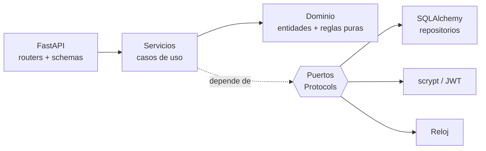

# 🏥 API Clínica: agenda de citas médicas

[](https://github.com/zulnidi/api_clinica/actions/workflows/ci.yml)

API REST en **FastAPI** para gestionar pacientes, médicos y citas, con reglas de agenda reales (horario de atención, sin choques, cancelación con anticipación) y autenticación con JWT.

> **English summary:** a REST API for clinic appointment scheduling built with FastAPI, SQLAlchemy and JWT auth. It follows a clean/hexagonal architecture: pure domain rules, use-case services that depend on ports (Protocols), and swappable adapters (SQLAlchemy, scrypt, JWT, clock). 49 tests, 99% coverage (measured), ruff and CI.

## ✨ Qué hace

- **Autenticación:** registro, login y rutas protegidas con token JWT (contraseñas con scrypt y sal aleatoria).
- **Pacientes:** crear, consultar, editar, listar con búsqueda y paginación (documento único).
- **Médicos:** crear, listar por especialidad y consultar.
- **Citas:** agendar, cancelar, completar, listar por médico, paciente o día.
- **Disponibilidad:** franjas libres de un médico en una fecha.

### Reglas de negocio ([`app/domain/rules.py`](app/domain/rules.py))

| Regla | Detalle |
|---|---|
| Duración | Citas de 30 minutos, en punto o y media |
| Horario | Lunes a viernes, 8:00 a 18:00 (hora de Bogotá, configurable) |
| Sin choques | Un médico o un paciente no pueden tener dos citas que se solapen |
| Pasado | No se agenda en el pasado |
| Cancelación | Solo citas programadas y con al menos 2 horas de anticipación |
| Completar | Solo citas programadas que ya ocurrieron |

## 🧱 Arquitectura



Las dependencias apuntan hacia adentro: el dominio no importa nada del framework.

| Capa | Carpeta | Contenido |
|---|---|---|
| Dominio | [`app/domain`](app/domain) | Entidades, errores y reglas de agenda (funciones puras) |
| Aplicación | [`app/application`](app/application) | [`ports.py`](app/application/ports.py) (interfaces) y [`services.py`](app/application/services.py) (casos de uso) |
| Infraestructura | [`app/infrastructure`](app/infrastructure) | SQLAlchemy, hash de contraseñas, JWT, reloj |
| API | [`app/api`](app/api) | Routers, esquemas Pydantic y composición de dependencias |

### Decisiones de diseño (SOLID)

- **S:** un servicio por responsabilidad (`AuthService`, `PatientService`, `DoctorService`, `AppointmentService`); las reglas viven en `rules.py`.
- **O:** para otra base de datos (PostgreSQL) solo se cambia la URL o se agrega otro repositorio; los servicios no cambian.
- **L/I:** los repositorios cumplen interfaces pequeñas (`PatientRepository`, `DoctorRepository`...), y las pruebas usan versiones en memoria intercambiables ([`tests/fakes.py`](tests/fakes.py)).
- **D:** los servicios dependen de `Protocol`s, no de SQLAlchemy. El único lugar que elige implementaciones es [`app/api/dependencies.py`](app/api/dependencies.py).
- **Reloj inyectable:** las reglas de tiempo (pasado, cancelación, expiración del token) se prueban sin esperar.
- **Errores de dominio → HTTP en un solo lugar:** [`app/main.py`](app/main.py) traduce `NotFoundError` (404), `ConflictError` (409), `ValidationError` (422) y `AuthenticationError` (401).

## 🛠️ Stack

Python 3.13 · FastAPI · SQLAlchemy 2 · Pydantic 2 · PyJWT · SQLite · pytest · ruff · GitHub Actions

## 🚀 Cómo ejecutarlo

```bash
python -m venv .venv && source .venv/bin/activate   # Windows: .venv\Scripts\activate
pip install -r requirements-dev.txt
cp .env.example .env                                # y define JWT_SECRET (mín. 32 caracteres)
export $(grep -v '^#' .env | xargs)                 # o usa tu gestor de entorno
uvicorn app.main:create_app --factory --reload
```

Documentación interactiva (OpenAPI) en `http://localhost:8000/docs`.

### Variables de entorno

| Variable | Descripción | Por defecto |
|---|---|---|
| `JWT_SECRET` | Secreto de firma (**obligatorio**, ≥ 32 caracteres) | — |
| `DATABASE_URL` | URL de SQLAlchemy | `sqlite:///./clinic.db` |
| `JWT_EXPIRES_MINUTES` | Vigencia del token | `60` |
| `CLINIC_TIMEZONE` | Zona horaria de la clínica | `America/Bogota` |
| `CORS_ORIGINS` | Orígenes permitidos, separados por coma | `http://localhost:5173` |

## 🔌 Endpoints

| Método | Ruta | Descripción | Auth |
|---|---|---|---|
| GET | `/health` | Estado del servicio | No |
| POST | `/auth/register` · `/auth/login` | Registro y login (devuelve `access_token`) | No |
| POST / GET | `/patients` | Crear / listar (`q`, `limit`, `offset`) | Sí |
| GET / PUT | `/patients/{id}` | Consultar / editar | Sí |
| POST / GET | `/doctors` | Crear / listar (`specialty`) | Sí |
| GET | `/doctors/{id}` · `/doctors/{id}/availability?date=AAAA-MM-DD` | Consultar / franjas libres | Sí |
| POST / GET | `/appointments` | Agendar / listar (`doctor_id`, `patient_id`, `date`) | Sí |
| GET | `/appointments/{id}` | Consultar | Sí |
| POST | `/appointments/{id}/cancel` · `/complete` | Cambiar estado | Sí |

Ejemplo:

```bash
TOKEN=$(curl -s -X POST localhost:8000/auth/login -H 'content-type: application/json' \
  -d '{"email":"recepcion@clinica.co","password":"clave-segura-1"}' | python -c "import sys,json;print(json.load(sys.stdin)['access_token'])")
curl -X POST localhost:8000/appointments -H "authorization: Bearer $TOKEN" -H 'content-type: application/json' \
  -d '{"patient_id":1,"doctor_id":1,"start":"2030-01-08T10:00:00-05:00","reason":"Control"}'
```

## 🧪 Pruebas

```bash
pytest --cov=app --cov-report=term-missing
ruff check . && ruff format --check .
```

49 pruebas en tres niveles: **reglas de dominio** ([`test_rules.py`](tests/test_rules.py)), **servicios** con repositorios en memoria ([`test_services.py`](tests/test_services.py)) y **API de extremo a extremo** con SQLite en memoria ([`test_api.py`](tests/test_api.py)). Cobertura medida: 99 %. También se verificó el arranque real con `uvicorn` (registro, login, ruta protegida y OpenAPI).

## 📁 Estructura

```
app/
├── domain/          # entidades, errores, reglas de agenda
├── application/     # puertos (Protocols) y servicios
├── infrastructure/  # SQLAlchemy, seguridad, reloj
├── api/             # routers, schemas, dependencias
├── main.py          # app factory
└── settings.py
tests/
```

## 🔮 Próximos pasos

- Migraciones con Alembic y PostgreSQL en producción.
- Roles (administrador, médico, recepción) y borrado lógico.
- Recordatorios de citas por correo.

## 👩‍💻 Autora

**Zullie Nicole Díaz López**: [GitHub](https://github.com/zulnidi)
